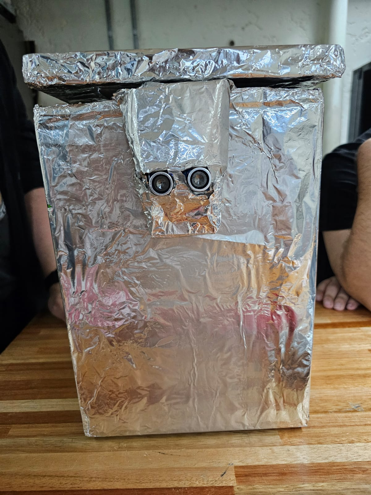

# Trash Masters

## Descripcion

Este repositorio contiene la documentación sobre el desarrollo y construcción de un contenedor de basura automático. El sistema cuenta con apertura por proximidad y un sensor de obstáculos que permite detectar si el contenedor está lleno, indicando cuándo es necesario vaciarlo.

*Nota:* Este proyecto se realiza durante el curso **Laboratorio STEAM+** de la
tecnicatura **Redes y Software** del [**Instituto Tecnico Informatico**] de **ITI**.

## Integrantes

- Joaquin Garcia
- Federico Bardecio
- Pablo Puerto
- Luis Guarguana

## Documentación

- [Informe de Avance - Agosto 2026](documentacion/avance1.md)
- [Informe de Avance - Septiembre 2026](documentacion/avance2.md)
- [Informe de Avance - Octubre 2026](documentacion/avance3.md)
- [Documentación técnica](documentacion/documentacion_tecnica.md)

## Código fuente

- [`codigo/microbit-TrashMastersV4.py`](codigo/microbit-TrashMastersV4.py)

## Presentación Final

- [`presentacion/presentacion-final.pptx`](presentacion/presentacion-final.pptx)
- [`Video avance 1`](https://youtube.com/shorts/BcGTUgdnKSw?feature=share)
- [`Video avance 2`](https://youtube.com/shorts/w3Xi0eUzK4U?feature=share)
- [`Video avance 3`](https://youtube.com/shorts/QUtSmvSVxcA?feature=share)
