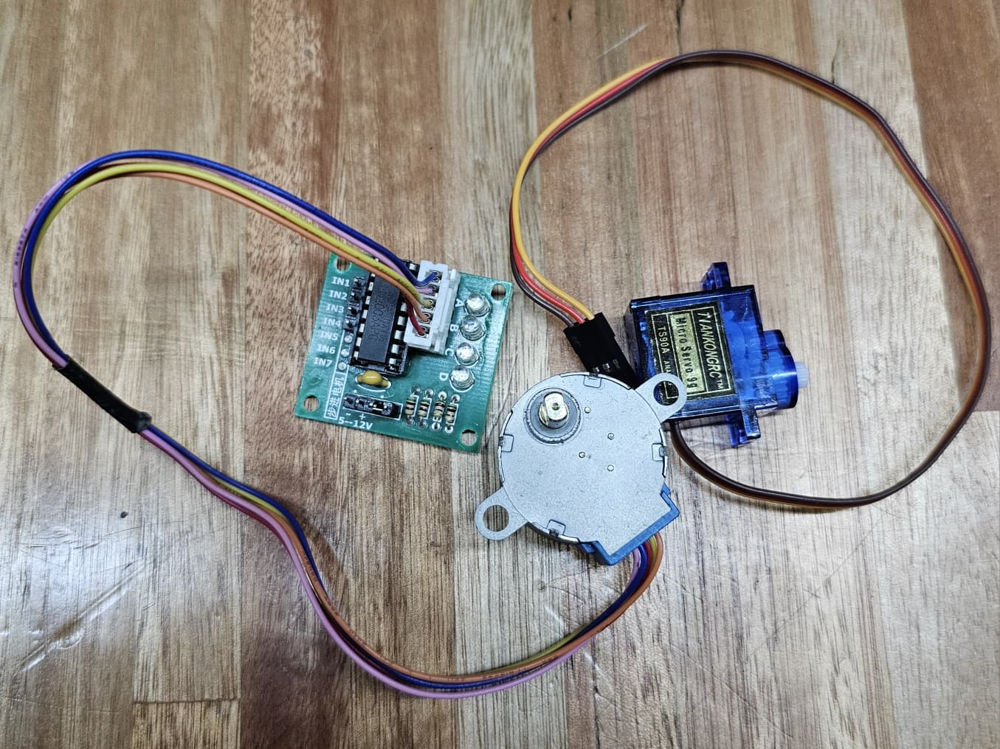
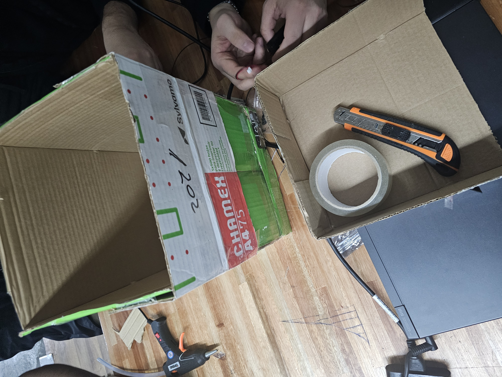
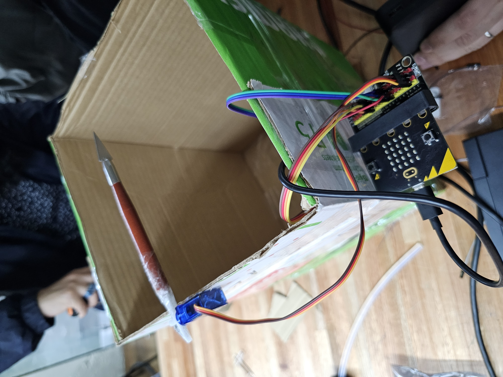
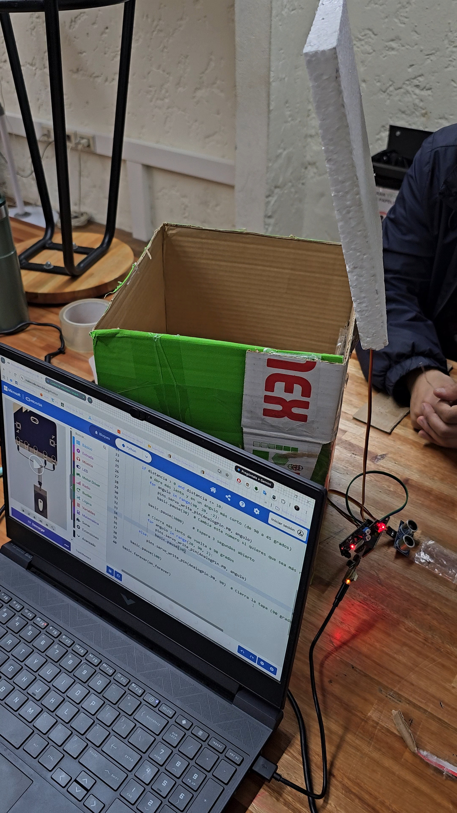
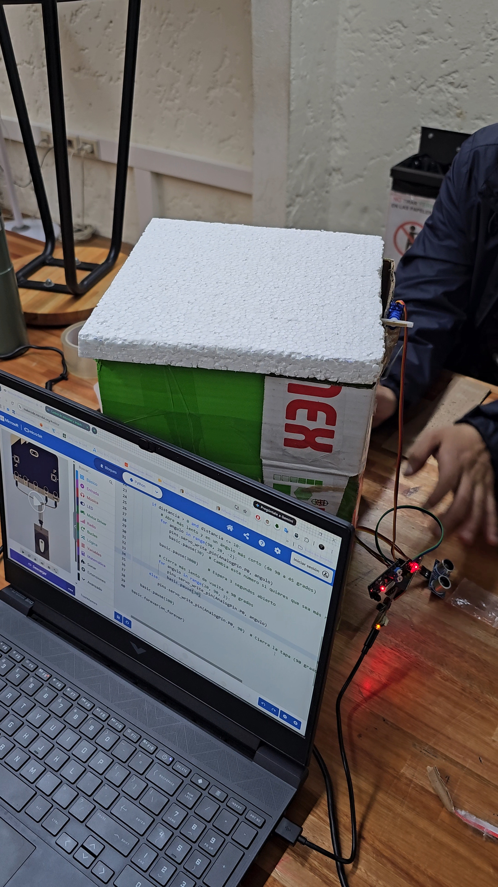

# Informe de Avance 2: Septiembre 2026

## 03/9/2026
**Tareas completadas:** Realizamos pruebas con un motor de pasos para evaluar si puede sustituir nuestro servomotor, con el fin de poder mover una tapa mas pesada y resistente.

## 10/9/2026
**Tareas completadas:** Diseñamos una papelera de un tamaño funcional y probamos su correcto funcionamiento. 
**Proximos pasos:**  Diseñar una tapa de un material más liviano y lograr que el movimiento de apertura y cierre sea uniforme. 

 
[Testeo del mecanismo](https://youtube.com/shorts/w3Xi0eUzK4U)

## 17/9/2026
**Tareas completadas:** Implementamos una nueva tapa y modificamos el código para que el movimiento de la misma se realizara más lento y en un ángulo más corto. 
**Proximos pasos:**  Mejorar el sistema de apertura y la estetica del diseño. 

 
[Testeo del mecanismo](https://youtube.com/shorts/HSC6TrHSgB8) 
**Codigo Makecode:**(https://makecode.microbit.org/S05695-82759-85973-68650)

