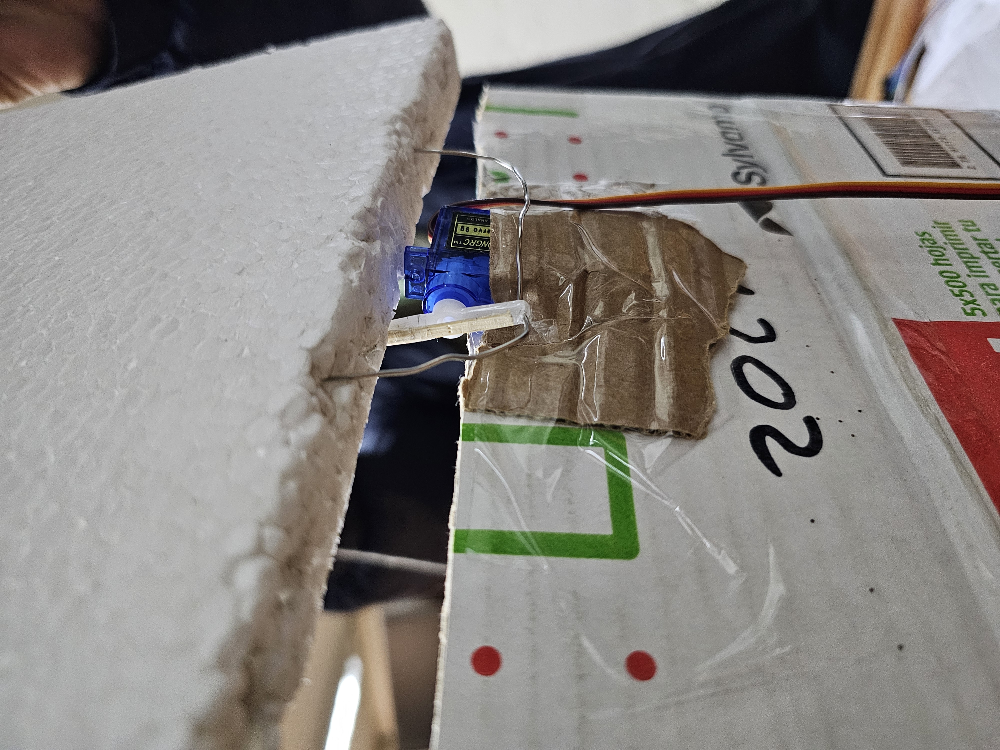
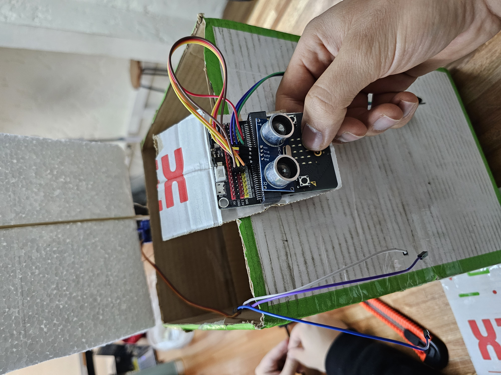
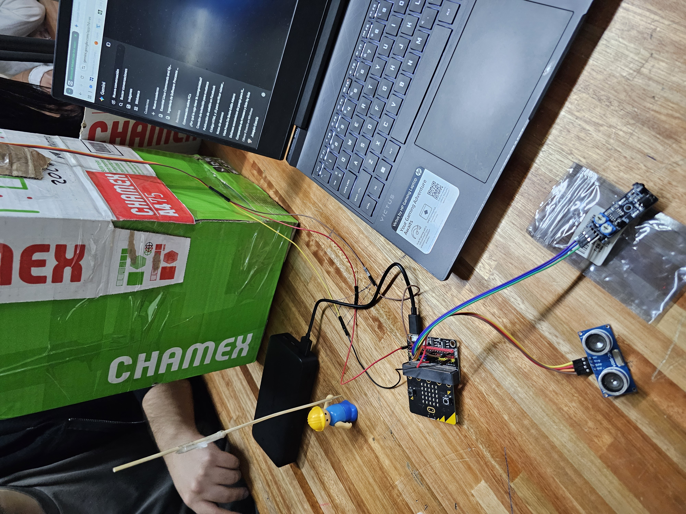
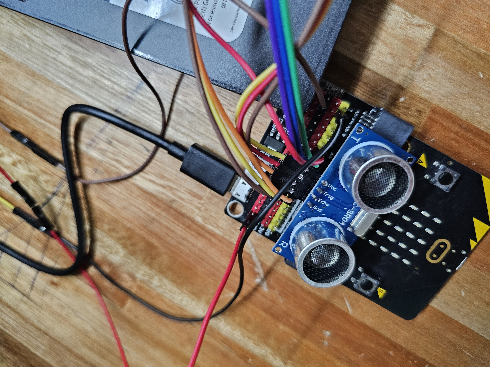
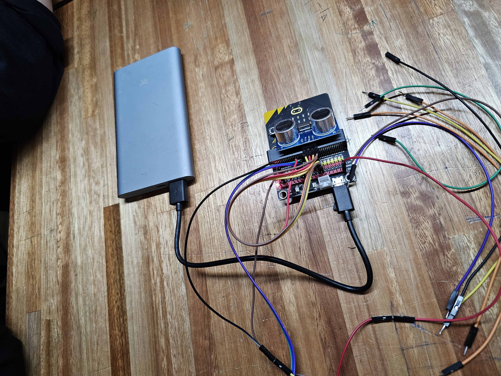
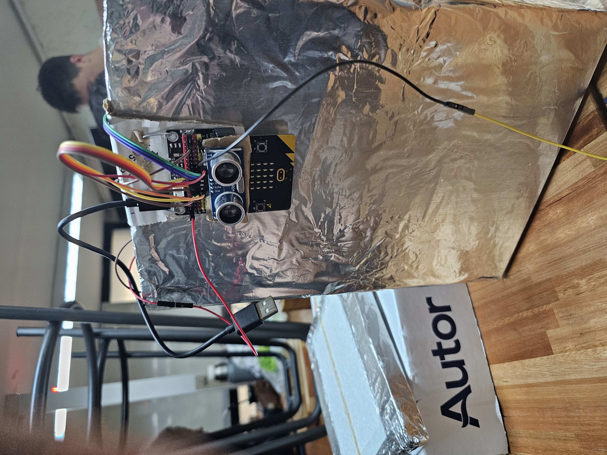
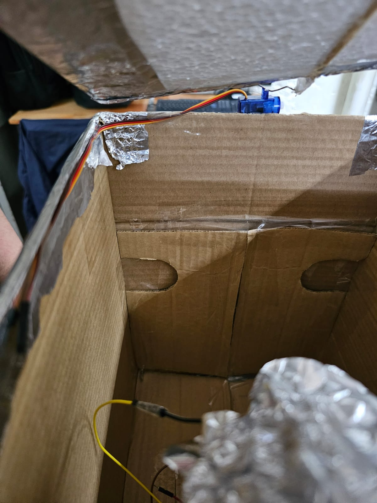
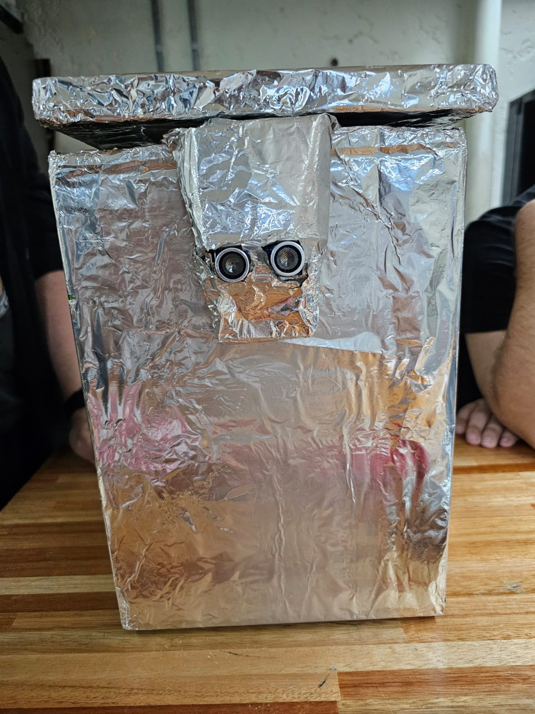

# Informe de Avance 3: Octubre 2026

## 01/10/2026

**Tareas completadas:** Realizamos ajustes en el montaje de los componentes electrónicos y reforzamos la estabilidad de los cables en la placa micro:bit. 
**Proximos pasos:**  Evaluar la respuesta del sensor ultrasónico ante diferentes ángulos y ajustar la autonomía de la alimentación. 

 
**Codigo Makecode:**(https://makecode.microbit.org/S12345-67890-12345-67890)

## 08/10/2026

**Tareas completadas:** Calibramos la distancia de detección del sensor ultrasónico HC-SR04 para evitar aperturas involuntarias al pasar cerca. 
**Proximos pasos:**  Ajustar el tiempo de retardo en el cierre automático de la tapa para un movimiento más natural. 

 
[Testeo del mecanismo](https://youtube.com/shorts/QUtSmvSVxcA)

## 22/10/2026

**Tareas completadas:** Aplicamos mejoras estéticas al cuerpo principal de la papelera y modificamos el código para optimizar el pulso del servomotor en el puerto P0. 
**Proximos pasos:**  Realizar una ronda de pruebas de estrés con aperturas continuas. 

 
 
**Codigo Makecode:**(https://makecode.microbit.org/S12345-67890-12345-67890)

## 29/10/2026

**Tareas completadas:** Realizamos las pruebas finales de integración de todo el sistema (sensor ultrasónico, micro:bit y servomotor) verificando su correcto funcionamiento en condiciones reales. 
**Proximos pasos:**  Finalizar la redacción del informe de proyecto y preparar la presentación del prototipo. 

 
[Testeo del mecanismo](https://youtube.com/shorts/ejemplo1029)
