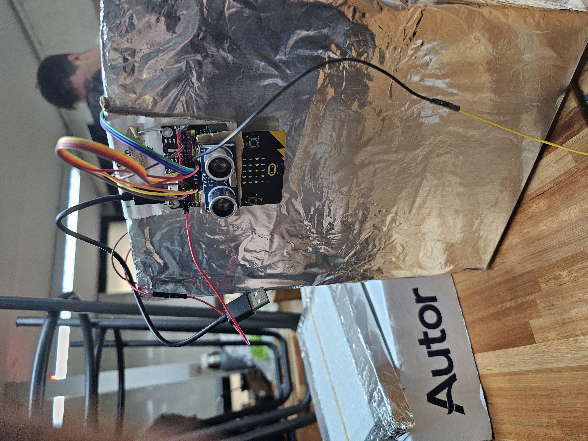
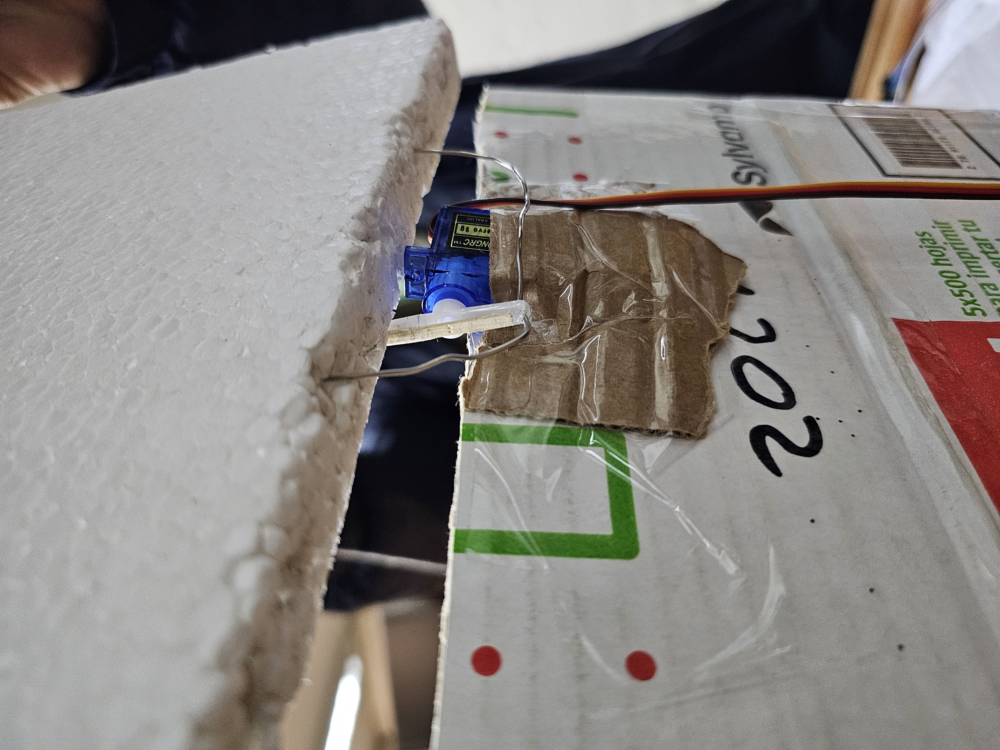
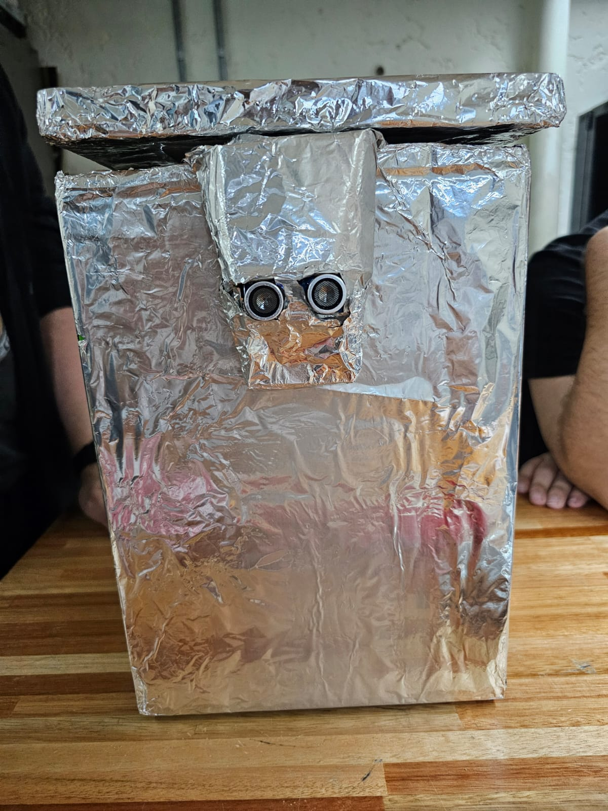
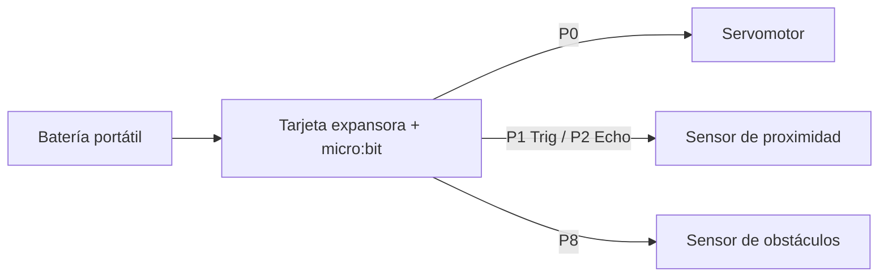
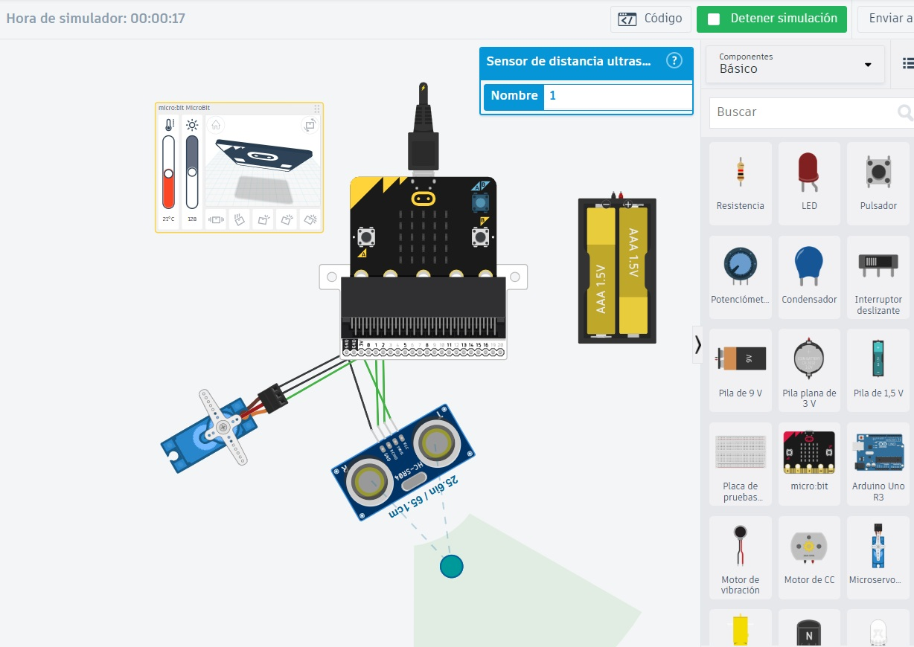

# Documentación Técnica

*Fecha: 15 de noviembre de 2026*

Este documento contiene la documentación técnica para el proyecto STEAM del curso **Laboratorio STEAM+** de la tecnicatura **Redes y Software** del **Instituto Tecnológico de Informática** de **UTU** año 2026.

# Proyecto: Contenedor de basura automático

## 1. Integrantes
- Joaquin Garcia
- Federico Bardecio
- Pablo Puerto
- Luis Guarguana

## 2. Descripción
El proyecto busca desarrollar un contenedor de basura inteligente diseñado para optimizar la gestión de residuos y promover un uso más eficiente e higiénico. El sistema central es gestionado por una placa programable micro:bit, la cual procesa las señales de los sensores y coordina las respuestas mecánicas en tiempo real.

Para garantizar una experiencia sin contacto, el contenedor cuenta con un sensor de proximidad que detecta al usuario, activando un servomotor para abrir la tapa de forma automática. Una vez que la persona sale del campo de detección, el sistema espera un lapso de 3 segundos antes de volver a cerrar la tapa de forma segura.

Además, el dispositivo incorpora un sensor de obstáculos interno que monitorea la capacidad del recipiente. Si se detecta que el contenedor está lleno, la micro:bit envía la orden de bloquear el servomotor, impidiendo que la tapa se vuelva a abrir para evitar el desborde y la sobrecarga de residuos.

**Problema que se busca resolver:** los contenedores de basura tradicionales obligan a tocar la tapa o un pedal, lo que genera contacto con superficies sucias, y no avisan cuando están llenos, por lo que se desbordan con facilidad.

**Solución:** un contenedor que abre solo al detectar una mano cercana, se cierra automáticamente a los pocos segundos y avisa (con una cara en la pantalla de la micro:bit) cuando está lleno, bloqueando la tapa hasta que sea vaciado.

## 3. Materiales

**Estructura y mecánica**
- Caja de cartón (caja de hojas A4)
- Aluminio
- Espuma plast
- Alambre
- Palitos de altura o palitos de brochette
- Cinta adhesiva
- Pega blanca

**Electrónica**
- Placa micro:bit
- Tarjeta expansora para micro:bit
- Sensor de proximidad (ultrasónico)
- Sensor de obstáculos (infrarrojo)
- Servomotor
- Cables de protoboard
- Batería portátil

## 4. Diseño Mecánico

### Funcionamiento mecánico
La estructura imita un tacho de basura clásico. La tapa es una pieza de espuma plast que gira sobre un lado de la caja. Un servomotor, fijado cerca de la tapa, mueve un alambre que está unido a ella: cuando el servo gira hacia la posición de apertura el alambre levanta la tapa, y cuando vuelve a la posición inicial la baja y la cierra.

### Armado paso a paso

**Paso 1 – Preparar la base.**
Tomamos una caja de hojas A4 para recrear la forma de un depósito de basura.

**Paso 2 – Cortar la tapa.**
Cortamos la espuma plast del tamaño de la caja, de manera que la tapa coincida con la abertura y pueda abrir y cerrar sin trabarse.

**Paso 3 – Forrar con aluminio.**
Con el aluminio medimos y cortamos según las medidas de la caja. En este caso cortamos cuatro lados y dos perfiles, uno para la parte superior y otro para la inferior.

**Paso 4 – Pegar el revestimiento.**
Presentamos cada lado sobre la caja y, con la cinta adhesiva, vamos adhiriendo lado a lado, cubriendo cada pedazo sobre el otro. Esto permite cubrir todo el depósito y darle una apariencia más familiar, que simula los botes de basura clásicos.

**Paso 5 – Armar el mecanismo de la tapa.**
Usamos el alambre para generar el movimiento de abrir y cerrar la tapa con el servomotor: un extremo se une al servo y el otro a la tapa. Los palitos de brochette sirven de apoyo y refuerzo, y la pega blanca fija las piezas de espuma plast y cartón.

**Paso 6 – Ubicar los sensores y la electrónica.**
El sensor de proximidad se coloca en el frente, por fuera, apuntando hacia donde el usuario acerca la mano. El sensor de obstáculos se coloca en el interior, orientado hacia el espacio donde se acumula la basura. La micro:bit con su tarjeta expansora y la batería portátil quedan fijadas a la caja.

### Fotografías




## 5. Diseño Electrónico

### Funcionamiento electrónico
La micro:bit, montada sobre la tarjeta expansora, es el cerebro del sistema. Lee dos sensores y controla un actuador:

- **Sensor de proximidad (ultrasónico):** mide la distancia a la mano del usuario. Si está a 10 cm o menos, se ordena abrir la tapa.
- **Sensor de obstáculos (infrarrojo):** está dentro del contenedor y detecta cuando la basura llegó al nivel máximo.
- **Servomotor:** abre y cierra la tapa según las órdenes de la micro:bit.

Todo el conjunto se alimenta con una batería portátil, por lo que el contenedor funciona sin estar conectado a la computadora.

### Conexiones

| Componente | Pin del componente | Pin de la micro:bit / expansora |
|---|---|---|
| Servomotor | Señal | P0 |
| Sensor ultrasónico | Trig | P1 |
| Sensor ultrasónico | Echo | P2 |
| Sensor de obstáculos (infrarrojo) | OUT | P8 |
| Todos los componentes | VCC | 5 V / 3 V de la tarjeta expansora (según el componente) |
| Todos los componentes | GND | GND de la tarjeta expansora |


### Diagrama de conexión



Agregar la captura del diagrama de Tinkercad en la carpeta `imagenes/`:



## 6. Diseño Software

### Funcionamiento del software
El programa se desarrolló en **MakeCode (Python)** y corre en un ciclo infinito que repite constantemente este flujo:

1. Lee el sensor de obstáculos (P8) para saber si el contenedor está lleno.
2. Si **no está lleno**, mide la distancia con el sensor ultrasónico (P1/P2). Si la mano está a 10 cm o menos, abre la tapa, muestra una cara feliz, espera 3 segundos y la vuelve a cerrar.
3. Si **está lleno**, muestra una cara triste y mantiene la tapa cerrada, sin responder al sensor de proximidad. Para poder abrirla igualmente (por ejemplo, al vaciarlo) se debe tocar el logo táctil de la micro:bit.
4. Los botones **A** y **B** permiten ajustar manualmente la tapa, moviéndola de a 5° dentro del rango permitido.

### Bloques de código más importantes

- **Constantes de ángulos:** la tapa está cerrada a 90° y abierta a 20°.
- **Función `mover_tapa(a)`:** limita el ángulo al rango permitido y lo envía al servomotor con `pins.servo_write_pin`.
- **Función `abrir_y_cerrar()`:** abre la tapa, espera 3 segundos y la cierra.
- **Lectura del sensor de llenado:** `pins.digital_read_pin(DigitalPin.P8)`. El módulo infrarrojo entrega nivel bajo (0) cuando detecta un obstáculo.
- **Caras en la pantalla:** muestran solo la boca (sin ojos) y están invertidas, porque a la micro:bit se le pegaron ojos físicos.

### Código fuente

El código se guarda en la carpeta `codigo/` del repositorio (`codigo/microbit-TrashMastersV4.py`):

```python
# Contenedor de basura automático - micro:bit (MakeCode Python)
# Requiere la extensión "sonar" (sensor ultrasónico) en MakeCode

TAPA_CERRADA = 90
TAPA_ABIERTA = 20
DISTANCIA_ACTIVACION = 10   # cm
TIEMPO_ABIERTA = 3000       # ms
PASO_MANUAL = 5             # grados por pulsación

angulo = TAPA_CERRADA

# Caras sin ojos (solo la boca), invertidas
CARA_FELIZ = images.create_image("""
    . # # # .
    # . . . #
    . . . . .
    . . . . .
    . . . . .
""")
CARA_TRISTE = images.create_image("""
    # . . . #
    . # # # .
    . . . . .
    . . . . .
    . . . . .
""")

def mover_tapa(a):
    global angulo
    angulo = max(TAPA_ABIERTA, min(TAPA_CERRADA, a))
    pins.servo_write_pin(AnalogPin.P0, angulo)

def abrir_y_cerrar():
    mover_tapa(TAPA_ABIERTA)
    CARA_FELIZ.show_image(0)
    basic.pause(TIEMPO_ABIERTA)
    mover_tapa(TAPA_CERRADA)
    basic.clear_screen()

def esta_lleno():
    # El sensor infrarrojo entrega 0 cuando detecta un obstáculo
    return pins.digital_read_pin(DigitalPin.P8) == 0

def on_button_a():
    mover_tapa(angulo - PASO_MANUAL)   # subir la tapa (abrir)
input.on_button_pressed(Button.A, on_button_a)

def on_button_b():
    mover_tapa(angulo + PASO_MANUAL)   # bajar la tapa (cerrar)
input.on_button_pressed(Button.B, on_button_b)

mover_tapa(TAPA_CERRADA)

def on_forever():
    if esta_lleno():
        mover_tapa(TAPA_CERRADA)
        CARA_TRISTE.show_image(0)
        if input.logo_is_pressed():
            abrir_y_cerrar()
    else:
        distancia = sonar.ping(DigitalPin.P1, DigitalPin.P2, PingUnit.CENTIMETERS)
        if distancia > 0 and distancia <= DISTANCIA_ACTIVACION:
            abrir_y_cerrar()
        else:
            basic.clear_screen()
    basic.pause(100)
basic.forever(on_forever)
```


## 7. Referencias y recursos
- [Documentación sobre pines del micro:bit](https://makecode.microbit.org/device/pins)
- [Referencia de servomotores en MakeCode](https://makecode.microbit.org/reference/pins/servo-write-pin)
- [Instructables – inspiración para documentar el armado](https://www.instructables.com)
- [Repositorio del proyecto](https://github.com/JoakoGC-ITI/proyecto-steam/)

## 8. Otros

**Posibles mejoras a futuro**
- Agregar un aviso sonoro o luminoso cuando el contenedor esté lleno.
- Reemplazar el cartón por un material más resistente a la humedad.
- Incorporar un sensor que cuente cuántas veces se abrió la tapa.
- Sumar un tercer sensor para medir distintos niveles de llenado.

**Aprendizajes del equipo**
- Integración de sensores, actuadores y programación en un mismo prototipo.
- Calibración del servomotor para lograr un movimiento de tapa suave y sin trabas.
- Uso de materiales reciclados y de bajo costo para construir un prototipo funcional.
